# DevMentor

**DevMentor** is an AI-powered programming learning platform. It places
each learner on a path that matches their level, lets them write and run
code in the browser, evaluates their work automatically, and gives them
explanations, hints and feedback from an AI Mentor.

## 1. Requirements - INVEST, Use Cases and Acceptance Criteria

This section defines what DevMentor must provide, who uses it, the value
it delivers and the testable conditions that confirm each feature works.

### 1.1 Product Mind Map


The core value of the product comes from **Learn with AI Mentor**,
**Coding Workspace**, **Courses & Lessons**, **Assessment & Evaluation**
and **Personalized Learning Path**. Authentication & Authorization,
Dashboard and Content Management & Admin are supporting capabilities
that let the product run.

> **Mind map update pending.** The learner flow was redesigned in the UI
> prototype (§2.3). The mind map image still shows leaves that changed:
> "Khám phá khóa học" (removed, US12), "Placement Test" (now the
> competency assessment, US04), "Coding challenges" (now lessons inside
> the learning path, US06), "Khóa học đang học" (now learning paths,
> US25), "Thống kê bài tập" (removed, US26) and "Thành tích & Streak"
> (streak only, US27). The onboarding survey (US32), competency profile
> (US33) and AI-added practice (US34) have no leaf yet.

### 1.2 INVEST Requirements

The V1 backlog below is an initial proposal. It has one User Story per
leaf of the mind map, so every mind map feature can be traced to a
story, a use case, acceptance criteria, business rules, APIs, data and
tests; US32–US34 come from the UI redesign and wait for their mind map
leaves. Removed stories keep their ID. The core learning loop is:
**survey and competency assessment → confirm the competency profile →
follow a personalized path (one course, reordered) → study the lesson →
practice code → get AI Mentor support → get evaluated → the path adapts
and mastery and progress update**.

| Criterion | Meaning in DevMentor |
| --- | --- |
| **Independent** | Each User Story keeps dependencies on other stories to a minimum so stories can be built and released in a flexible order; unavoidable dependencies such as accounts, courses or the grader are listed in the Depends on column. |
| **Negotiable** | A User Story describes the outcome the user needs, not an early technical design. |
| **Valuable** | A feature must help learners acquire knowledge, practice, improve their skills, or help admins run the content and the platform. |
| **Estimable** | Scope, business rules, inputs/outputs and dependencies are clear enough for the team to estimate. |
| **Small** | A User Story is small enough to design, build and test within one short iteration. |
| **Testable** | Each story has observable acceptance criteria, covering the success path and error or permission cases. |

#### V1 User Story Backlog

| ID | Mind map group | User Story | Actor | Priority | Depends on | Status |
| --- | --- | --- | --- | --- | --- | --- |
| US01 | Authentication & Authorization | As a visitor, I want to register an account so that I can start onboarding and get my own learning path. | Visitor | Must | None | Draft |
| US02 | Authentication & Authorization | As a user, I want to log in and log out so that I can access my own space securely and end my session. | Learner, Admin | Must | US01 | Draft |
| US03 | Authentication & Authorization | As an admin, I want features and data restricted by role, with unauthorized access blocked, so that learner data and admin functions stay protected. | Admin | Must | US02 | Draft |
| US04 | Assessment & Evaluation | As a learner, I want to take a competency assessment generated from my survey answers so that DevMentor knows my starting level without asking about topics I have not learned. | Learner | Should | US32, LLM | Draft |
| US05 | Assessment & Evaluation | As a learner, I want to take an end-of-lesson quiz so that I can check my understanding of a topic. | Learner | Should | US14, question bank | Draft |
| US06 | Assessment & Evaluation | As a learner, I want to solve coding challenges in my learning path so that I can test my problem-solving skills beyond practice exercises. | Learner | Could | US18 | Draft |
| US07 | Assessment & Evaluation | As a learner, I want my submitted code evaluated with a score and performance metrics so that I know how good my solution is, not only whether it passes. | Learner | Should | US18 | Draft |
| US08 | Personalized Learning Path | As a learner, I want a learning path built from my competency profile, using one course of my chosen language reordered so that I skip what I know and start with my gaps. | Learner | Should | US04, US33, US11 | Draft |
| US09 | Personalized Learning Path | As a learner, I want the next lesson recommended from my learning and assessment history so that I always know what to study next. | Learner | Should | US08, US14 | Draft |
| US10 | Personalized Learning Path | As a learner, I want my knowledge gaps detected so that I can focus on the concepts I am weak at. | Learner | Should | US11 | Draft |
| US11 | Personalized Learning Path | As a learner, I want my mastery of each concept tracked so that I can see how my skills develop. | Learner | Should | US04, concept tagging | Draft |
| US12 | Courses & Lessons | ~~As a visitor or learner, I want to explore courses and enroll in one so that I can choose content that fits my goals.~~ Removed: the system picks the course for each path (BR-025). | — | — | — | Removed |
| US13 | Courses & Lessons | As a learner, I want to view the chapters and lessons of my learning path so that I understand the order, what was skipped or added, and where I am. | Learner | Must | US08 | Draft |
| US14 | Courses & Lessons | As a learner, I want to watch video lessons and read lessons with code examples, with checkpoint questions and notes, so that I learn topic by topic. | Learner | Must | US13 | Draft |
| US15 | Courses & Lessons | As a learner, I want to do the coding practice lessons of my path so that I apply what I just learned. | Learner | Must | US14, US16 | Draft |
| US16 | Coding Workspace | As a learner, I want a code editor in the browser so that I can write C, C++, Python, Java, JavaScript or SQL without installing anything. | Learner | Must | US02 | Draft |
| US17 | Coding Workspace | As a learner, I want to run my code and see its output so that I can test it before submitting. | Learner | Must | US16, sandbox | Draft |
| US18 | Coding Workspace | As a learner, I want to submit my solution and view the grading result so that I know whether it meets the requirements. | Learner | Must | US17, test cases (US29) | Draft |
| US19 | Learn with AI Mentor | As a learner, I want the AI Mentor to explain concepts from the lesson so that I understand what I am studying. | Learner | Must | US14 | Draft |
| US20 | Learn with AI Mentor | As a learner, I want step-by-step hints when I am stuck so that I can find the solution myself. | Learner | Must | US15 | Draft |
| US21 | Learn with AI Mentor | As a learner, I want the AI Mentor to analyze my errors so that I understand the cause and how to fix them. | Learner | Must | US17 | Draft |
| US22 | Learn with AI Mentor | As a learner, I want the AI Mentor to review my code so that I can improve its readability, structure and efficiency. | Learner | Should | US18 | Draft |
| US23 | Learn with AI Mentor | As a learner, I want to ask the AI Mentor questions in the context of the current lesson, video position and code so that the answers are relevant to what I am learning. | Learner | Must | US14 | Draft |
| US24 | Dashboard | As a learner, I want an overview of my learning progress so that I can see what I have done and continue where I left off. | Learner | Must | US14 | Draft |
| US25 | Dashboard | As a learner, I want to see the learning paths I follow, one per language, so that I can resume any of them quickly. | Learner | Must | US08 | Draft |
| US26 | Dashboard | ~~As a learner, I want statistics on my exercises so that I can see how my practice is going.~~ Removed: the Dashboard shows lessons completed and average quiz score instead (US24). | — | — | — | Removed |
| US27 | Dashboard | As a learner, I want a learning streak so that I stay motivated to learn regularly. | Learner | Could | US24 | Draft |
| US28 | Content Management & Admin | As an admin, I want to manage courses and their modules so that the catalog stays up to date. | Admin | Must | US03 | Draft |
| US29 | Content Management & Admin | As an admin, I want to manage lessons, exercises, test cases and assessment questions so that learners get accurate content and grading. | Admin | Must | US28 | Draft |
| US30 | Content Management & Admin | As an admin, I want to manage users, their roles and account status so that I can control access. | Admin | Must | US03 | Draft |
| US31 | Content Management & Admin | As an admin, I want system statistics and monitoring so that I can track usage, AI cost and service errors. | Admin | Should | US03 | Draft |
| US32 | Personalized Learning Path | As a learner, I want to answer a short onboarding survey about the language, my goals, my experience and how well I know each topic so that the assessment and path fit me. | Learner | Must | US01 | Draft |
| US33 | Personalized Learning Path | As a learner, I want to review my competency profile and change how each topic is handled before my path is created so that the path matches what I really know. | Learner | Should | US04 | Draft |
| US34 | Personalized Learning Path | As a learner, I want practice added to my path for the concepts I am weak at so that my path keeps adapting to my results. | Learner | Should | US05, US10, US18 | Draft |

Priority: **Must** is required for V1; **Should** is important but can
ship after the core flows; **Could** is an extension once the data and
platform are in place.

#### Acceptance Criteria

The acceptance criteria below are an initial draft for each User Story
and must be reviewed together with the
[business rules](docs/requirements/business-rules.md) before
implementation.

| ID | Acceptance criteria |
| --- | --- |
| US01 | Registering with a display name, a new email, a valid password and accepted terms creates an active `LEARNER` account, starts a session and opens the onboarding survey. A duplicate email or invalid data shows an error on each affected field. The password is never stored or returned in plain text. The Google and GitHub buttons are not active in V1. |
| US02 | Valid credentials log the user in: learners land on the Dashboard, or on the onboarding step they left if no competency profile is confirmed yet; admins land on Statistics & Monitoring. Register and Log in are two tabs of one screen. Wrong credentials or a locked account show one generic error that does not reveal whether the email exists. Logging out revokes the refresh token and returns to the landing page; the old session can no longer call protected APIs. |
| US03 | Every protected API checks authentication, role and ownership in the backend. A request without a valid session gets `401` and the UI redirects to Log in, then back to the requested page. A request with the wrong role gets `403` and the UI shows the 403 screen. A request for another learner's resource gets `404`. Menu items and buttons the user cannot use are hidden, but hiding is not the security control. |
| US04 | The questions are generated from the survey: 3 per "Unsure" topic, 1 per "Confident" topic, none for "Not learned". Each question has options A–D and an "I don't know" button; numbered boxes show answered, skipped and current questions. There is no pass or fail. After submission an analysis screen shows its stages, then the competency profile shows the overall level, the score, the AI Mentor's comment and the score per topic. The learner can retake with new questions until the profile is confirmed. Submitted answers cannot be changed. |
| US05 | The learner can start and submit an end-of-lesson quiz, which is scored automatically; a question may have several correct answers. The result shows pass or not, the score per skill and the wrong answers with the AI Mentor's explanation. Correct answers are shown only after submission. The quiz can be retaken; each attempt is stored separately and updates concept mastery. A weak result can add practice to the path (US34). |
| US06 | Challenges appear as lessons in the learning path, with difficulty and concepts; there is no separate challenge list. The learner solves a challenge in the Coding Workspace and it is graded by test cases like an exercise. Hint, Debug and Review are unavailable until the challenge is `ACCEPTED`. There is no leaderboard. |
| US07 | Each submission shows a score from 0 to 100 (share of test cases passed), the verdict, and the runtime and memory of each sample test plus the maximum across all tests. The score comes only from execution results, never from AI. The best score per exercise is kept. |
| US08 | Confirming the competency profile creates a path for the chosen language from one published course: lessons of skipped topics are marked skipped, review topics are labeled "Quick review", and weak topics come first where prerequisites allow. Each item shows a reason written by the LLM, but the course and the order are decided by rules. There is no path without an assessment. |
| US09 | "Continue" opens the first lesson of the path that is neither completed nor skipped, AI-added items included; a video resumes at the last position watched. The Dashboard uses the most recently active path. |
| US10 | Concepts below the mastery threshold that have enough evidence are detected as knowledge gaps, sorted by lowest mastery, and trigger AI-added practice (US34). The list updates after each graded activity. |
| US11 | Mastery is shown per concept as a percentage on the competency profile and the Dashboard (one tab per language). A concept with no evidence shows the survey self-assessment, labeled "not tested". It updates after each submission and assessment or quiz attempt tagged with that concept. Learners see only their own mastery. |
| US12 | Removed. |
| US13 | The path detail shows a course card (level, chapters, lessons, estimated weeks, progress, Continue) and the chapters as an accordion. Each lesson shows its type (Video, Reading, Practice, Quiz, Challenge), duration and labels: "Quick review", "AI added", in progress, skipped; the number of skipped lessons is shown. Skipped lessons can be opened but do not count toward progress. Draft and hidden items are not shown. |
| US14 | A video lesson shows the video with Summary, Transcript and Notes tabs, a collapsible course sidebar and the AI Mentor panel. Checkpoint questions pop up at set times; they are not scored and give right/wrong feedback. A reading lesson shows content and code examples. The learner marks video and reading lessons complete. A non-existent or unpublished lesson returns `404`; a visitor is sent to Log in. |
| US15 | A practice lesson opens the Coding Workspace with the statement (requirements as a checklist, examples), sample tests, starter code and any read-only files. It is complete once it has an `ACCEPTED` submission. |
| US16 | The editor runs in the browser with syntax highlighting for the exercise's language (C, C++, Python, Java, JavaScript, SQL), line numbers and auto-indent; it shows the learner's file and any read-only files as tabs and loads the starter code. An unsaved draft survives a page reload in the same browser. The learner can reset to the starter code. Source code larger than 64 KB is rejected. |
| US17 | The learner can run code with custom input or against the sample tests and gets stdout, stderr, status and run time. Code that exceeds the time or memory limit is stopped with a clear message. Code never runs in the API process. Running does not change progress. |
| US18 | Submitting runs all test cases and returns a verdict. The learner sees full detail for sample tests and only pass/fail counts for hidden tests. Every submission is stored in an immutable history the learner can browse. |
| US19 | The learner can ask the AI Mentor to explain a concept or a selected passage of the lesson, or press a quick action ("Explain more simply", "Give another example"). The explanation uses the lesson and the current video position as context, includes an example and names the lesson section it used. A loading state is shown; if the LLM fails or times out, an error with Retry is shown and the request does not count toward the quota. |
| US20 | Each hint request returns the next hint level (at most 3) based on the statement and the learner's current code, phrased as a guiding question that points to the relevant line where possible. A hint never contains a complete solution. |
| US21 | After a failed run or submission, the AI Mentor explains the likely cause, points to the related lines and suggests a direction to fix it, without rewriting the whole solution. Only sample test data is used. |
| US22 | Review is available for code the learner has submitted. Feedback covers correctness risks, readability, structure and complexity. It does not change the verdict or score and does not contain a complete rewritten solution. |
| US23 | The AI Mentor panel shows what it is following (lesson, video time or code). A question is sent with that context. The answer is streamed, may link to points in the video, usually ends with a question back to the learner, shows the lesson sources it used, and the learner can rate it helpful or not. Off-topic questions are declined politely. The conversation is kept per lesson. |
| US24 | The dashboard shows a greeting, a "Continue learning" card with the minutes of video left, the streak, lessons completed (total and this week), the average quiz score, a to-do list (AI-added practice and quizzes not yet done) and the competency profile per language, using only the learner's own data. Empty states are not yet designed. |
| US25 | The Dashboard lists the paths being followed with progress and next lesson. My learning paths shows one card per language with status, level, date created, progress, skipped and AI-added counts and next lesson, filtered by All, In progress and Completed. "Create new path" runs onboarding for a language that has no path in progress. |
| US26 | Removed. |
| US27 | The dashboard shows the current streak with the last 7 days. The streak resets after a day with no qualifying activity. There are no achievements or badges in V1. |
| US28 | The admin can create, edit, reorder and hide courses and modules. Unpublished content is not visible to learners. A non-admin calling an admin API gets `403`. |
| US29 | The admin can create, edit and hide lessons, practice exercises, coding challenges, quiz and placement questions, tag them with concepts, and manage test cases marked sample or hidden. An exercise cannot be published without at least one test case and a reference solution that passes all of them. Hidden tests are never returned by learner APIs. |
| US30 | The admin can list and search users, lock and unlock accounts and change roles. A locked account cannot log in and its existing sessions are rejected. An admin cannot demote or lock themselves, and at least one active admin always remains. |
| US31 | The admin can see, for a chosen date range: active users, enrollments, code runs and submissions, AI requests, tokens and cost per day, sandbox and LLM error rates, and service health. An alert is shown when daily AI cost exceeds the configured budget. Only aggregated data is shown; learner source code and conversations are not. |
| US32 | The survey has 4 steps ("Question x / 4", Back, Continue): language (C, C++, Python, Java, JavaScript, SQL or Other), goals (several allowed, plus Other), experience (5 levels) and a self-assessment of each topic ("Not learned", "Unsure", "Confident"). An intro step then shows the number of assessment questions and the estimated minutes. Onboarding cannot be skipped; leaving resumes at the same step. |
| US33 | Each topic shows its level, its score ("33% (1/3 correct)" or "Not tested, from survey") and a suggested handling: Learn from scratch, Review or Skip, which the learner can change. Totals per handling are shown, and fully correct topics are grouped as "will be skipped". "Confirm and start learning" creates the path; "Retake the assessment" returns to the assessment. |
| US34 | After a quiz, or when a knowledge gap is found, the system can insert an LLM-generated practice lesson for the weak concept before the next chapter, labeled "AI added", and shows "Learning path updated". It is inserted only if its reference solution passes all its tests. It is graded by tests like any exercise, its hidden tests are never shown, and only that learner sees it. |

### 1.3 Use Cases

Proposed V1 use cases, grouped by mind map feature group:

| ID | Use Case | Mind map group | Primary actor | Outcome |
| --- | --- | --- | --- | --- |
| UC01 | Register an account | Authentication & Authorization | Visitor | An account is created when the data is valid, and onboarding starts. |
| UC02 | Log in and log out | Authentication & Authorization | Learner, Admin | The user is authenticated and reaches only what their role allows; logout ends the session. |
| UC03 | Complete onboarding and the competency assessment | Assessment & Evaluation, Personalized Learning Path | Learner | The survey is answered, the level assessed, the profile confirmed and a learning path created. |
| UC04 | Take a quiz | Assessment & Evaluation | Learner | The quiz is scored, mastery is updated and practice may be added to the path. |
| UC05 | Solve a coding challenge | Assessment & Evaluation | Learner | A challenge in the path is graded and evaluated. |
| UC06 | Follow a learning path | Personalized Learning Path | Learner | The learner sees their paths, the lessons of each, and what to study next. |
| UC07 | ~~Explore and enroll in courses~~ | Removed | — | — |
| UC08 | Study a lesson | Courses & Lessons | Learner | A video or reading lesson is studied and progress is updated by the rules. |
| UC09 | Practice a coding exercise | Courses & Lessons, Coding Workspace | Learner | The learner submits a solution and gets a verdict and evaluation. |
| UC10 | Write and run code | Coding Workspace | Learner | Code runs in the sandbox and returns its output. |
| UC11 | Get a hint or debugging help | Learn with AI Mentor | Learner | The AI Mentor gives guidance without giving away the solution. |
| UC12 | Ask the AI Mentor | Learn with AI Mentor | Learner | The AI Mentor explains a concept or answers a question in lesson context. |
| UC13 | Get an AI code review | Learn with AI Mentor | Learner | The learner receives quality feedback on submitted code. |
| UC14 | View the dashboard | Dashboard | Learner | The learner sees progress, paths, streak, to-do and competency profile. |
| UC15 | Manage learning content | Content Management & Admin | Admin | Courses, lessons, exercises, test cases and questions are created or updated. |
| UC16 | Manage users and roles | Content Management & Admin | Admin | Account status and roles are managed. |
| UC17 | Monitor the system | Content Management & Admin | Admin | The admin sees usage, AI cost, errors and service health. |

Full specification of each use case, User Story ↔ Use Case traceability
and shared rules: [Actors, Roles and Use Cases](docs/03-use-cases.md).

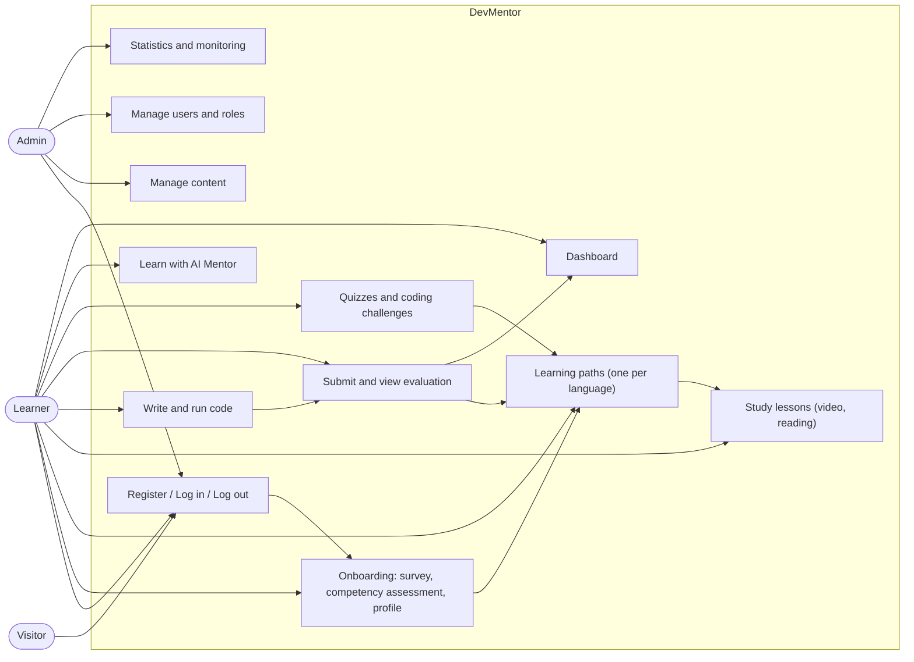

### 1.4 Roles and Permissions

The roles below are an initial proposal. Actual permissions must be
confirmed in the business rules and in security testing.

| Capability | Visitor | Learner | Admin |
| --- | --- | --- | --- |
| View landing page | Yes | Yes | Yes |
| Register / log in | Yes | N/A (logged in) | N/A (logged in) |
| Log out | No | Yes | Yes |
| Onboarding survey and competency assessment | No | Yes | Can test |
| View learning paths, study lessons | No | Yes | Can view to check content |
| Practice exercises, run and submit code | No | Yes | Can test |
| Quizzes, coding challenges | No | Yes | Can test |
| Learn with AI Mentor | No | Yes | Can test |
| Competency profile, learning paths and dashboard data | No | Own data only | Own data only |
| Manage courses, lessons, exercises, test cases, questions | No | No | Yes |
| Manage users and roles | No | No | Yes |
| System statistics and monitoring | No | No | Yes |

The backend must enforce authentication and authorization on every API
and resource. Hiding buttons or screens in the frontend is not a
security control.

### 1.5 Scope, Business Rules and Non-Functional Requirements

- [V1 Scope](docs/01-scope.md): problem, target users, V1 goals and
    non-goals, assumptions to confirm, backlog gaps.
- [Business Rules](docs/requirements/business-rules.md): `BR-001` to
    `BR-037` (access control, content publishing, lesson types and
    video, grading and evaluation, hidden tests, onboarding and the
    competency assessment, quizzes, AI Mentor, mastery, knowledge gaps,
    learning paths, AI-generated practice, recommendations, dashboard
    and streak).
- [Non-Functional Requirements](docs/requirements/non-functional-requirements.md):
    performance, sandbox limits, AI latency/quota/cost, security,
    privacy, operations, maintainability and usability.

## 2. Information Architecture, Screen Hierarchy and UI/UX

The information architecture organizes features around the user's
goals and mirrors the mind map groups. Every screen must define its
access rules and its loading, empty, validation, error, saving and
success states.

### 2.1 Information Architecture

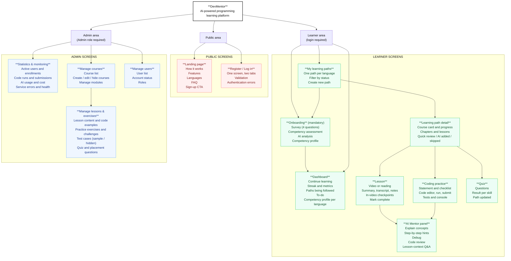

### 2.2 Screen Hierarchy

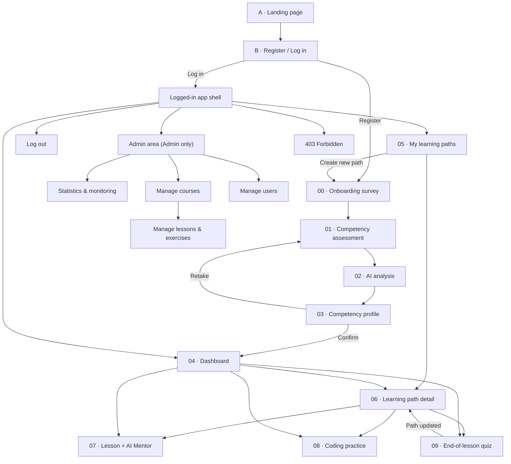

New learners go through 00 → 03 before the Dashboard; returning
learners log in straight to the Dashboard (or back to the onboarding
step they left). Main learning flow: Learning path → Lesson → Coding
practice → Run/Submit → Evaluation and AI Mentor support → Quiz → the
path adapts (AI-added practice) and mastery and progress update → Next
lesson.

The AI Mentor panel must clearly show what it is following (lesson,
video time or code), the question, the answer, the lesson sources used
(if any), a processing state and a way to rate the answer. It guides
with questions rather than giving answers; for hints, the UI reveals
one level at a time instead of showing a full solution.

### 2.3 Current UI Prototype

The learner flow has an interactive prototype of 12 screens (canvas
"DevMentor — UI", 2026-11-01, shadcn/ui style). Admin screens are not
designed yet.

| Screen | Role |
| --- | --- |
| A · Landing page | Product introduction, CTA to Register |
| B · Register / Log in | One screen, two tabs; Register → survey, Log in → Dashboard |
| 00 · Onboarding survey | 4 survey questions + an intro to the assessment |
| 01 · Competency assessment | AI-generated multiple-choice questions with "I don't know" |
| 02 · AI analysis | Waiting screen with 4 stages |
| 03 · Competency profile | Assessment result; the learner adjusts each topic's handling |
| 04 · Dashboard | Home after login |
| 05 · My learning paths | One path per language |
| 06 · Learning path detail | The chapters and lessons of the course, reordered |
| 07 · Lesson + AI Mentor | Video, in-video checkpoint, Mentor chat |
| 08 · Coding practice | Statement, editor, tests, Mentor watching the code |
| 09 · End-of-lesson quiz | Multiple-choice quiz and result |

Not designed yet: admin screens, account settings, mobile layouts, dark
mode for the app, and empty, error and loading states.

#### Screenshots

Captured from the prototype at 1440 px wide; all data is the prototype's
sample learner (C path, pointers). The Dashboard still shows the "weekly
goal" metric, which was dropped from the requirements (BR-037) and will
be removed from the UI.

##### 1 · New learner: landing → onboarding

| A · Landing page | 00 · Onboarding survey (question 4) |
| --- | --- |
| 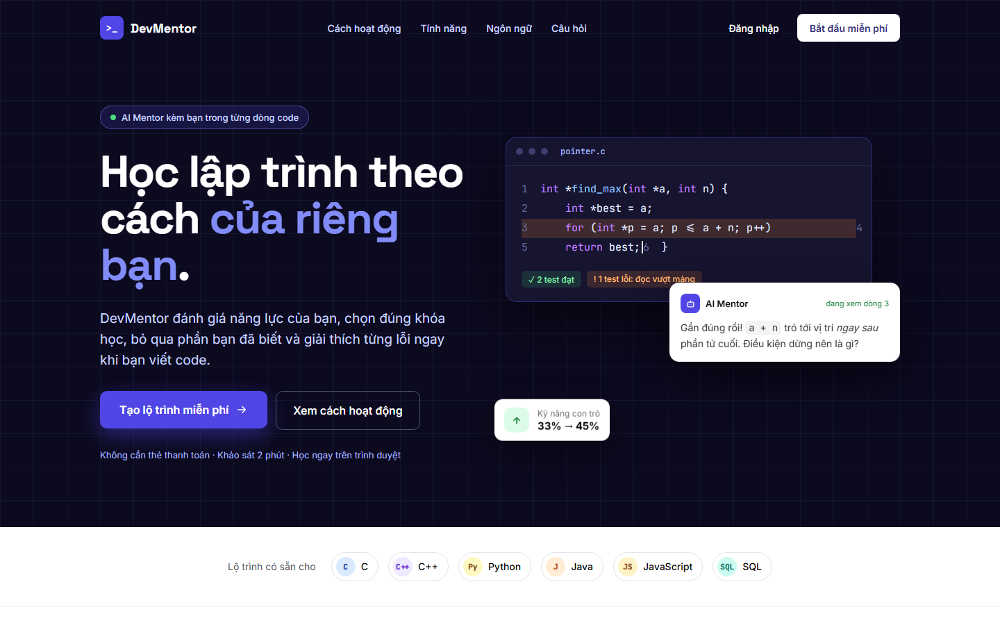 | 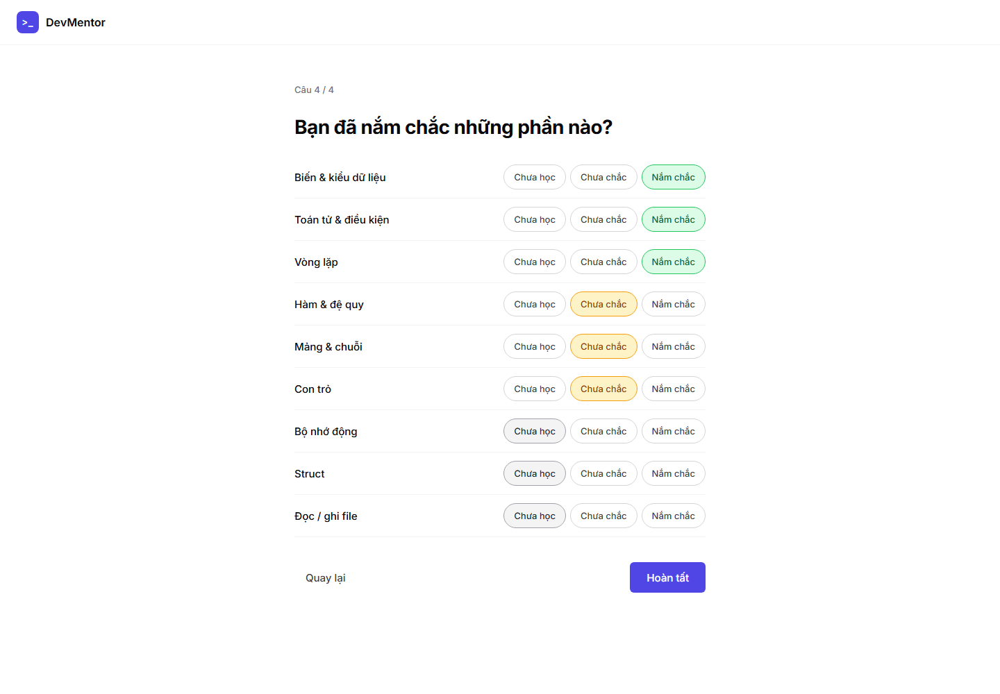 |

| 01 · Competency assessment | 03 · Competency profile |
| --- | --- |
| 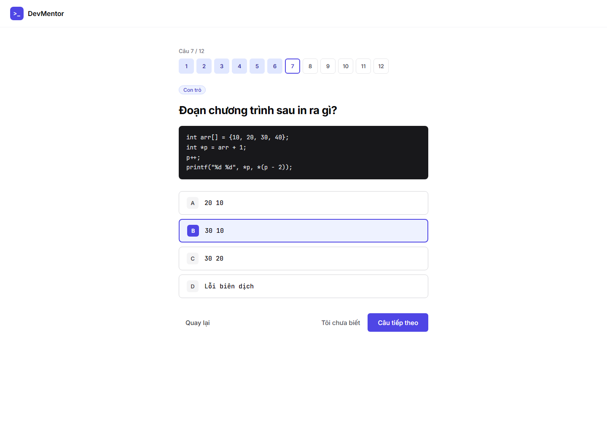 | 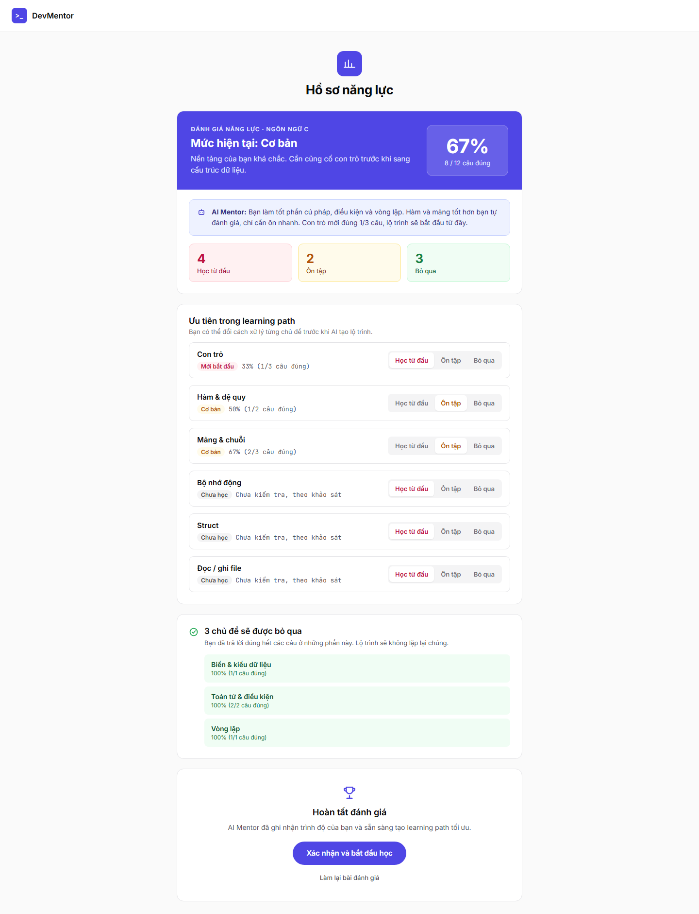 |

##### 2 · App: dashboard → learning path

| 04 · Dashboard | 06 · Learning path detail |
| --- | --- |
| 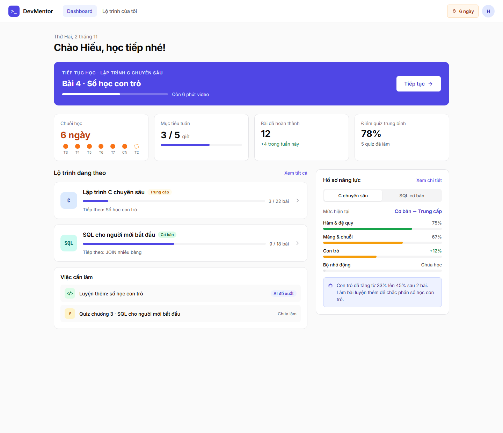 | 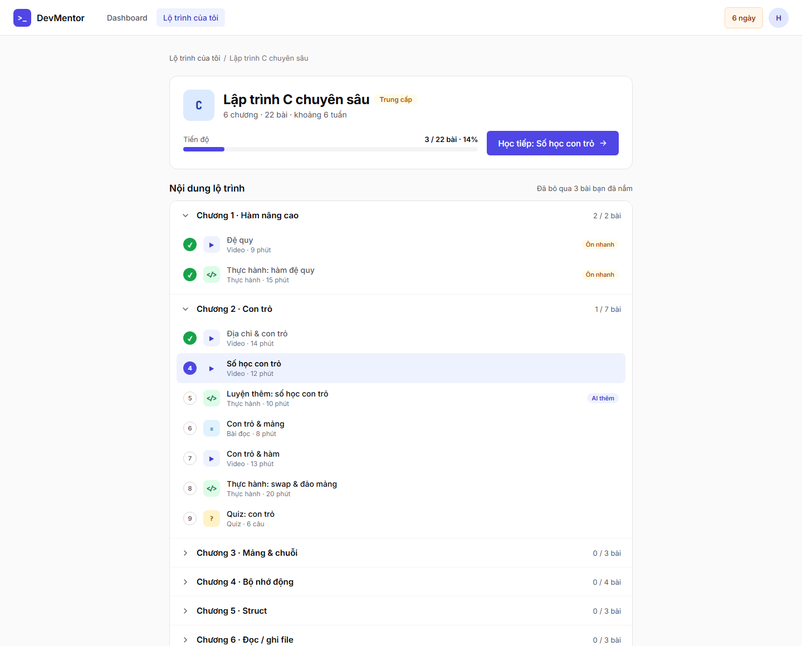 |

##### 3 · Learning: lesson → practice → quiz

| 07 · Lesson + AI Mentor | 08 · Coding practice |
| --- | --- |
| 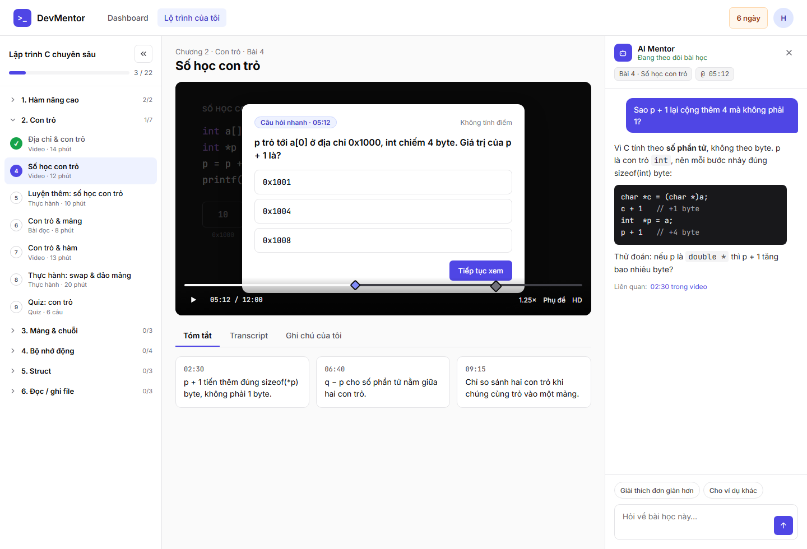 | 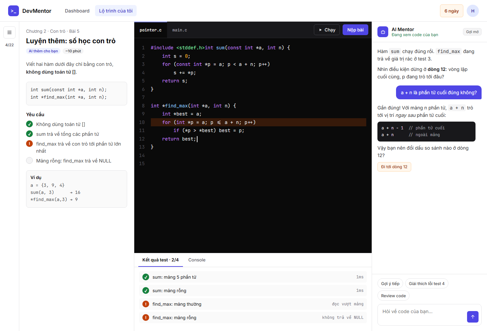 |

| 09 · End-of-lesson quiz |
| --- |
| 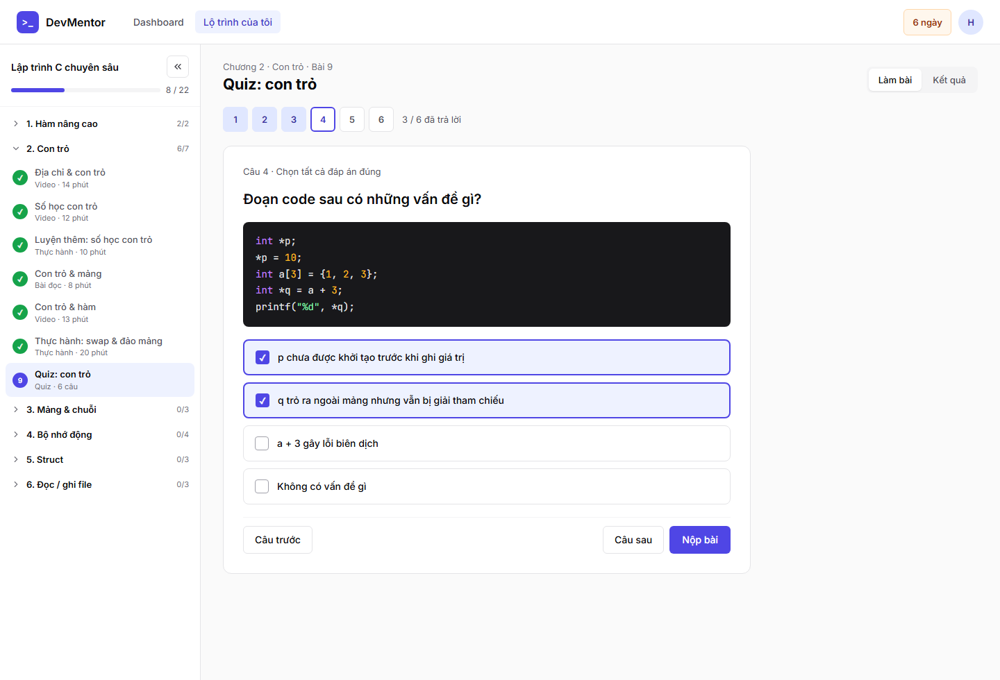 |

## 3. C4 Architecture

This section summarizes the architecture at three levels: System Context
(C1), Container (C2) and Component (C3). It is the proposed logical
architecture for V1, not a confirmed deployment diagram. The detailed
version, with element catalogs, components of the AI Mentor Service,
Background Worker and Code Execution Service, and dynamic diagrams of
the main flows, is in [C4 Architecture](docs/architecture/c4/README.md).

### C1 - System Context

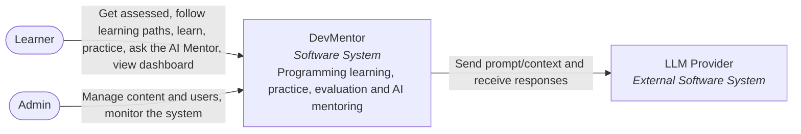

The code execution service is treated as an isolated container inside
DevMentor (see C2). If an external sandbox service is chosen later, it
must be added back to this diagram as an External Software System.

### C2 - Container

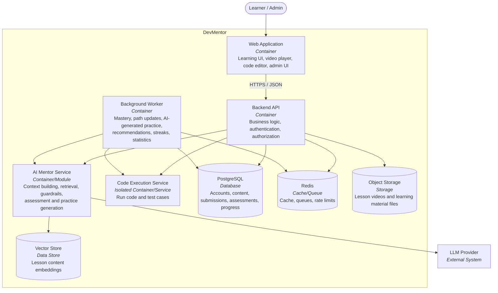

### C3 - Component

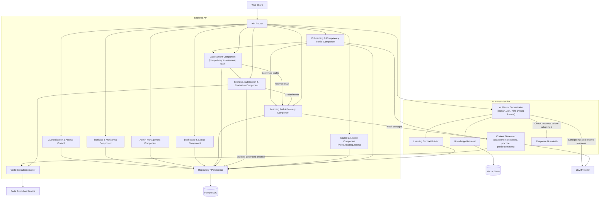

#### Architecture notes

- Start as a modular monolith: one backend split into clear business
    modules. Split out a service only when scaling, security isolation
    or independent deployment requires it.
- Code execution needs its own isolation boundary; user code never runs
    in the API process.
- The AI Mentor Orchestrator builds context and coordinates the Explain,
    Ask, Hint, Debug and Review tasks.
- RAG retrieves learning material; it does not replace the compiler,
    runtime or test engine.
- Whether a coding solution is right or wrong, and its evaluation
    score, is decided only by execution results against defined test
    cases.
- Course choice, lesson order, mastery, knowledge gaps and
    recommendations are rule-based in V1 and recalculated after each
    graded activity. The LLM writes explanations (profile comment,
    item reasons) and generates assessment questions and "AI added"
    practice; it never decides the order or a verdict.
- Generated practice is inserted into a path only after its reference
    solution passes all its tests in the sandbox.
- LLM calls need timeouts, token limits, cost control, appropriate
    logging and provider error handling.

Detailed documents:

- [C4 Architecture](docs/architecture/c4/README.md): C1–C3 with element
    catalogs, dynamic diagrams (onboarding, code submission, hints,
    adaptive practice), architecture principles and open decisions.

Planned (not yet created):

- arc42 Architecture Handbook: `docs/architecture/arc42/README.md`

## 4. Database Diagram and OpenAPI 3.0 Contract

This section outlines the storage model and the HTTP contract between
the frontend, the backend and related services. The schema and endpoints
below are proposals to be confirmed during detailed design.

### 4.1 Database Diagram

``` mermaid
erDiagram
    USERS ||--o{ ONBOARDING_SURVEYS : answers
    USERS ||--o{ COMPETENCY_PROFILES : has
    USERS ||--o{ LEARNING_PATHS : follows
    USERS ||--o{ SUBMISSIONS : creates
    USERS ||--o{ EXECUTIONS : runs
    USERS ||--o{ LEARNING_PROGRESS : owns
    USERS ||--o{ LESSON_NOTES : writes
    USERS ||--o{ AI_CONVERSATIONS : has
    USERS ||--o{ LEARNING_ACTIVITIES : records

    COURSES ||--o{ MODULES : contains
    MODULES ||--o{ LESSONS : contains
    LESSONS ||--o{ LESSON_CHECKPOINTS : has
    LESSONS ||--o| EXERCISES : includes
    EXERCISES ||--o{ EXERCISE_FILES : has
    EXERCISES ||--o{ TEST_CASES : has
    EXERCISES ||--o{ SUBMISSIONS : receives
    EXERCISES ||--o{ EXECUTIONS : runs

    LESSONS ||--o{ LEARNING_PROGRESS : tracks
    LESSONS ||--o{ LESSON_NOTES : has
    LESSONS ||--o{ AI_CONVERSATIONS : context_for
    EXERCISES ||--o{ AI_CONVERSATIONS : context_for
    AI_CONVERSATIONS ||--o{ AI_MESSAGES : contains

    CONCEPTS ||--o{ LESSON_CONCEPTS : maps
    LESSONS ||--o{ LESSON_CONCEPTS : maps
    CONCEPTS ||--o{ EXERCISE_CONCEPTS : maps
    EXERCISES ||--o{ EXERCISE_CONCEPTS : maps
    USERS ||--o{ CONCEPT_MASTERY : tracks
    CONCEPTS ||--o{ CONCEPT_MASTERY : measures

    ONBOARDING_SURVEYS ||--o{ ASSESSMENTS : generates
    LESSONS ||--o| ASSESSMENTS : quiz_of
    ASSESSMENTS ||--o{ ASSESSMENT_QUESTIONS : contains
    CONCEPTS ||--o{ ASSESSMENT_QUESTIONS : tests
    ASSESSMENTS ||--o{ ASSESSMENT_ATTEMPTS : receives
    USERS ||--o{ ASSESSMENT_ATTEMPTS : takes

    ONBOARDING_SURVEYS ||--o| COMPETENCY_PROFILES : produces
    ASSESSMENT_ATTEMPTS ||--o| COMPETENCY_PROFILES : scores
    COMPETENCY_PROFILES ||--o{ PROFILE_TOPICS : contains
    CONCEPTS ||--o{ PROFILE_TOPICS : rates
    COMPETENCY_PROFILES ||--o| LEARNING_PATHS : creates
    COURSES ||--o{ LEARNING_PATHS : used_by
    LEARNING_PATHS ||--o{ LEARNING_PATH_ITEMS : contains
    LESSONS ||--o{ LEARNING_PATH_ITEMS : appears_in
    USERS ||--o{ LEARNING_RECOMMENDATIONS : receives
    LESSONS ||--o{ LEARNING_RECOMMENDATIONS : suggested_in

    USERS {
        uuid id PK
        varchar email
        varchar password_hash
        varchar display_name
        varchar role
        boolean is_active
        timestamptz created_at
    }

    ONBOARDING_SURVEYS {
        uuid id PK
        uuid user_id FK
        varchar language
        varchar other_language
        jsonb goals
        varchar experience_level
        jsonb self_assessment "concept to NOT_LEARNED, UNSURE, CONFIDENT"
        timestamptz created_at
    }

    COMPETENCY_PROFILES {
        uuid id PK
        uuid user_id FK
        uuid survey_id FK
        uuid attempt_id FK
        varchar language
        varchar overall_level
        numeric score
        text ai_comment
        varchar status "DRAFT or CONFIRMED"
        timestamptz confirmed_at
    }

    PROFILE_TOPICS {
        uuid profile_id FK
        uuid concept_id FK
        numeric score "null when not tested"
        varchar source "ASSESSED or SURVEY"
        varchar suggested_handling "LEARN, REVIEW, SKIP"
        varchar chosen_handling "LEARN, REVIEW, SKIP"
    }

    COURSES {
        uuid id PK
        varchar title
        text description
        varchar language
        varchar difficulty
        varchar status
        timestamptz created_at
    }

    MODULES {
        uuid id PK
        uuid course_id FK
        varchar title
        int position
        varchar status
    }

    LESSONS {
        uuid id PK
        uuid module_id FK
        varchar type "VIDEO, READING, PRACTICE, QUIZ, CHALLENGE"
        varchar title
        text content
        varchar video_object_key
        int duration_seconds
        text summary
        text transcript
        int position
        varchar status
        uuid generated_for_user_id FK "null unless AI-generated"
    }

    LESSON_CHECKPOINTS {
        uuid id PK
        uuid lesson_id FK
        int at_second
        text prompt
        jsonb options
        text correct_answer
    }

    LESSON_NOTES {
        uuid user_id FK
        uuid lesson_id FK
        text content
        timestamptz updated_at
    }

    EXERCISES {
        uuid id PK
        uuid lesson_id FK
        varchar type "PRACTICE or CHALLENGE"
        varchar title
        text description
        text starter_code
        varchar difficulty
        varchar language "C, CPP, PYTHON, JAVA, JAVASCRIPT, SQL"
        varchar source "TEAM or AI"
        text reference_solution
        varchar status
    }

    EXERCISE_FILES {
        uuid id PK
        uuid exercise_id FK
        varchar path
        text content
        boolean is_read_only
    }

    TEST_CASES {
        uuid id PK
        uuid exercise_id FK
        text input_data
        text expected_output
        boolean is_sample
    }

    SUBMISSIONS {
        uuid id PK
        uuid user_id FK
        uuid exercise_id FK
        varchar language
        text source_code
        varchar verdict
        int passed_tests
        int total_tests
        numeric score
        int max_runtime_ms
        int max_memory_kb
        timestamptz submitted_at
    }

    EXECUTIONS {
        uuid id PK
        uuid user_id FK
        uuid exercise_id FK
        varchar language
        varchar status
        text stdout
        text stderr
        int duration_ms
        timestamptz created_at
    }

    LEARNING_PROGRESS {
        uuid id PK
        uuid user_id FK
        uuid lesson_id FK
        varchar status
        int video_position_seconds
        timestamptz completed_at
    }

    CONCEPTS {
        uuid id PK
        varchar name
        varchar language
        text description
    }

    LESSON_CONCEPTS {
        uuid lesson_id FK
        uuid concept_id FK
    }

    EXERCISE_CONCEPTS {
        uuid exercise_id FK
        uuid concept_id FK
    }

    CONCEPT_MASTERY {
        uuid id PK
        uuid user_id FK
        uuid concept_id FK
        numeric mastery_score
        int evidence_count
        timestamptz last_assessed_at
    }

    AI_CONVERSATIONS {
        uuid id PK
        uuid user_id FK
        uuid lesson_id FK
        uuid exercise_id FK
        varchar mode "EXPLAIN, ASK, HINT, DEBUG, REVIEW, GENERATE_ASSESSMENT, GENERATE_PRACTICE, PROFILE_COMMENT"
        timestamptz created_at
    }

    AI_MESSAGES {
        uuid id PK
        uuid conversation_id FK
        varchar role
        text content
        int video_position_seconds
        varchar model
        int input_tokens
        int output_tokens
        numeric cost_usd
        varchar feedback
        timestamptz created_at
    }

    ASSESSMENTS {
        uuid id PK
        uuid lesson_id FK "quiz lesson; null for competency"
        uuid survey_id FK "competency only"
        varchar title
        varchar type "COMPETENCY or QUIZ"
        varchar source "TEAM or AI"
        varchar status
    }

    ASSESSMENT_QUESTIONS {
        uuid id PK
        uuid assessment_id FK
        uuid concept_id FK
        text prompt
        jsonb options
        jsonb correct_answers
        boolean multiple_answers
        int position
    }

    ASSESSMENT_ATTEMPTS {
        uuid id PK
        uuid user_id FK
        uuid assessment_id FK
        jsonb answers "includes I_DONT_KNOW"
        numeric score
        timestamptz started_at
        timestamptz submitted_at
    }

    LEARNING_PATHS {
        uuid id PK
        uuid user_id FK
        uuid course_id FK
        uuid profile_id FK
        varchar language
        varchar status "IN_PROGRESS or COMPLETED"
        timestamptz created_at
        timestamptz last_activity_at
    }

    LEARNING_PATH_ITEMS {
        uuid id PK
        uuid path_id FK
        uuid lesson_id FK
        int position
        varchar status "NOT_STARTED, IN_PROGRESS, COMPLETED, SKIPPED"
        boolean is_quick_review
        boolean is_ai_added
        text reason
    }

    LEARNING_RECOMMENDATIONS {
        uuid id PK
        uuid user_id FK
        uuid lesson_id FK
        text reason
        varchar status
        timestamptz created_at
    }

    LEARNING_ACTIVITIES {
        uuid id PK
        uuid user_id FK
        varchar activity_type
        uuid reference_id
        date activity_date
        timestamptz created_at
    }
```

Main data groups:

- **Identity & Access:** Users, roles and account status.
- **Onboarding:** Onboarding Surveys, Competency Profiles, Profile
    Topics (score and handling per topic).
- **Learning Content:** Courses (one language each), Modules (shown as
    chapters), Lessons (video, reading, practice, quiz, challenge;
    AI-generated practice belongs to one learner), Lesson Checkpoints,
    Exercises, Exercise Files (read-only supporting files), Test Cases,
    Concepts.
- **Coding:** Executions and Submissions (with score and performance
    metrics for code evaluation).
- **Assessment:** Assessments (AI-generated competency assessment,
    quiz), Assessment Questions, Assessment Attempts.
- **Personalized Learning:** Learning Paths (one course per path, one
    path in progress per language), Learning Path Items, Learning
    Progress (including video position), Lesson Notes, Concept
    Mastery, Learning Recommendations.
- **Dashboard & Engagement:** Learning Activities (for streak and recent
    activity).
- **AI Mentor:** AI Conversations and AI Messages (with model, token
    counts, cost and learner feedback for statistics and cost control),
    including generation calls.

The `ENROLLMENTS`, `ACHIEVEMENTS` and `USER_ACHIEVEMENTS` tables were
removed with the course catalog and achievements.

These tables are a starting model. Unique constraints, indexes, audit
fields, deletion/retention policies, resource-level permissions and
secure test case storage must be added when the schema is finalized.

Planned documents (not yet created):

- Database diagram: `docs/DATABASE.md`
- Data model: `docs/05-data-model.md`
- Database migrations/schema: `backend/migrations/` (or the matching
    path once the repository layout is decided)

### 4.2 OpenAPI 3.0 API Documentation

The API contract will use OpenAPI 3.0, split by business area:

| API group | Responsibility |
| --- | --- |
| Authentication | Register, log in, log out, refresh session, current user |
| Onboarding | Survey, onboarding status, competency assessment generation, competency profile and confirmation |
| Learning Paths | My learning paths, path detail (chapters and items) |
| Lessons | Lesson content, video checkpoints, notes and completion |
| Exercises | Practice exercise and coding challenge details, starter code, read-only files |
| Executions | Run code in the sandbox |
| Submissions | Submit, grading result and code evaluation, submission history |
| Assessments | Quiz attempts; answering and submitting any attempt |
| AI Mentor | Explain, Ask, Hint, Debug, Review, answer feedback |
| Learning | Recommendations, mastery, knowledge gaps |
| Dashboard | Overview (continue learning, metrics, streak, paths, competency profile), to-do |
| Admin | Content, test cases, questions, users, statistics and monitoring |

The full contract, with request/response schemas, status codes and
error codes, is in [openapi.yaml](docs/api/openapi.yaml). The endpoints
below are a summary; none is implemented yet:

``` text
POST   /api/v1/auth/register
POST   /api/v1/auth/login
POST   /api/v1/auth/logout
POST   /api/v1/auth/refresh
GET    /api/v1/users/me

GET    /api/v1/onboarding/status
GET    /api/v1/onboarding/topics
POST   /api/v1/onboarding/surveys
POST   /api/v1/competency-assessments
GET    /api/v1/competency-profiles/{profileId}
PATCH  /api/v1/competency-profiles/{profileId}/topics
POST   /api/v1/competency-profiles/{profileId}/confirm

GET    /api/v1/learning-paths
GET    /api/v1/learning-paths/{pathId}
GET    /api/v1/lessons/{lessonId}
POST   /api/v1/lessons/{lessonId}/complete
PUT    /api/v1/lessons/{lessonId}/position
POST   /api/v1/lessons/{lessonId}/checkpoints/{checkpointId}/answer
GET    /api/v1/lessons/{lessonId}/notes
PUT    /api/v1/lessons/{lessonId}/notes

GET    /api/v1/exercises/{exerciseId}
POST   /api/v1/executions
GET    /api/v1/executions/{executionId}
POST   /api/v1/submissions
GET    /api/v1/submissions/{submissionId}
GET    /api/v1/exercises/{exerciseId}/submissions

POST   /api/v1/quizzes/{quizId}/attempts
GET    /api/v1/assessment-attempts/{attemptId}
PATCH  /api/v1/assessment-attempts/{attemptId}
POST   /api/v1/assessment-attempts/{attemptId}/submit

POST   /api/v1/ai/explain
POST   /api/v1/ai/ask
POST   /api/v1/ai/hint
POST   /api/v1/ai/debug
POST   /api/v1/ai/review
POST   /api/v1/ai/messages/{messageId}/feedback

GET    /api/v1/learning/recommendations
GET    /api/v1/learning/mastery
GET    /api/v1/learning/knowledge-gaps

GET    /api/v1/dashboard/overview
GET    /api/v1/dashboard/todo

GET    /api/v1/admin/courses
POST   /api/v1/admin/courses
PATCH  /api/v1/admin/courses/{courseId}
POST   /api/v1/admin/courses/{courseId}/modules
PATCH  /api/v1/admin/modules/{moduleId}
POST   /api/v1/admin/modules/{moduleId}/lessons
PATCH  /api/v1/admin/lessons/{lessonId}
POST   /api/v1/admin/exercises
PATCH  /api/v1/admin/exercises/{exerciseId}
GET    /api/v1/admin/exercises/{exerciseId}/test-cases
POST   /api/v1/admin/exercises/{exerciseId}/test-cases
PATCH  /api/v1/admin/test-cases/{testCaseId}
POST   /api/v1/admin/assessments
PATCH  /api/v1/admin/assessments/{assessmentId}
POST   /api/v1/admin/assessments/{assessmentId}/questions
PATCH  /api/v1/admin/assessment-questions/{questionId}
GET    /api/v1/admin/users
PATCH  /api/v1/admin/users/{userId}
GET    /api/v1/admin/stats
GET    /api/v1/admin/monitoring
```

Content is hidden or published by `PATCH`ing its `status` field. A
practice exercise is created with a `lessonId`; a coding challenge is
created with `type = CHALLENGE` and no lesson. Accounts are locked or
roles changed with `PATCH /api/v1/admin/users/{userId}`.

#### Proposed API conventions

- Use JSON for regular requests and responses.
- Endpoints that require authentication check the token/session in the
    backend.
- Admin endpoints check the Admin role in the backend.
- Validate input, limit request size and apply appropriate rate limits.
- Code execution APIs support asynchronous processing when execution
    exceeds the synchronous response threshold.
- Never return hidden test cases, answers or sensitive data to learners.
- Errors use RFC 7807 problem details with stable error codes (see the
    [error catalog](docs/api/README.md#errors)).
- Never log tokens, passwords, sensitive source code or unnecessary
    personal data.

#### API documents

- [OpenAPI 3.0 specification](docs/api/openapi.yaml): every endpoint,
    schema, status code and error code.
- [API documentation](docs/api/README.md): conventions, authentication,
    error catalog, asynchronous operations, streaming AI answers,
    request/response examples and an endpoint ↔ use case ↔ rule index.

## Scope and Assumptions to Confirm

So that the proposals above are not mistaken for final decisions, the
following points must be confirmed during analysis (the proposed default
for each is in [V1 Scope](docs/01-scope.md#v1-assumptions-to-confirm)):

1. **Audience and roles:** V1 targets students and self-learners in
    Vietnam, from never coded to basic. Is a separate instructor role
    needed?
2. **Programming languages:** Decided: C, C++, Python, Java,
    JavaScript and SQL (AS-02).
3. **Course content:** Decided: courses are written by the project
    team; competency assessment questions and "AI added" practice are
    generated by the LLM (AS-03). Open: how generated content is
    reviewed for quality.
4. **Code execution:** Which sandbox, resource limits and network/file
    policy?
5. **AI provider:** Which LLM, what budget per user, and how is response
    quality evaluated?
6. **RAG:** Which material may enter the knowledge base, and how is it
    updated and reviewed?
7. **Personalization:** Decided: rules choose the course and order;
    the LLM explains and generates practice (AS-07). Open: the level →
    course mapping and the thresholds (see the
    [business rules](docs/requirements/business-rules.md#open-questions)).
8. **Deployment:** Expected user scale, cloud environment, logging,
    monitoring and data protection requirements.
9. **Account self-service:** Profile editing, password change and
    password reset are not in the mind map. Are they out of V1?

## Contributing and Updating the Docs

When requirements or architecture change:

1. Update the mind map first, then the User Stories and Acceptance
    Criteria so each mind map leaf still maps to a story.
2. Re-check the use cases and permissions.
3. Update the screen hierarchy and related UI/UX flows.
4. Update the C4, database and OpenAPI diagrams when they change.
5. Add or update the matching tests.
6. Keep IDs such as `USxx`, `UCxx`, `BR-xxx` stable to support
    traceability.

------------------------------------------------------------------------

**DevMentor - Learn to code with a mentor by your side.**
