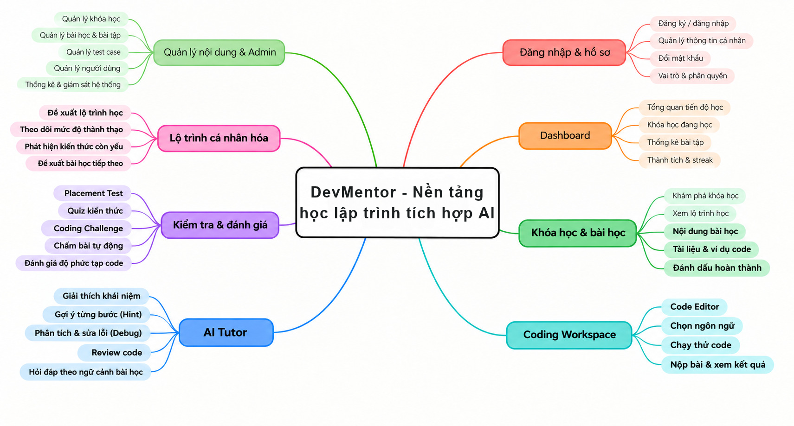
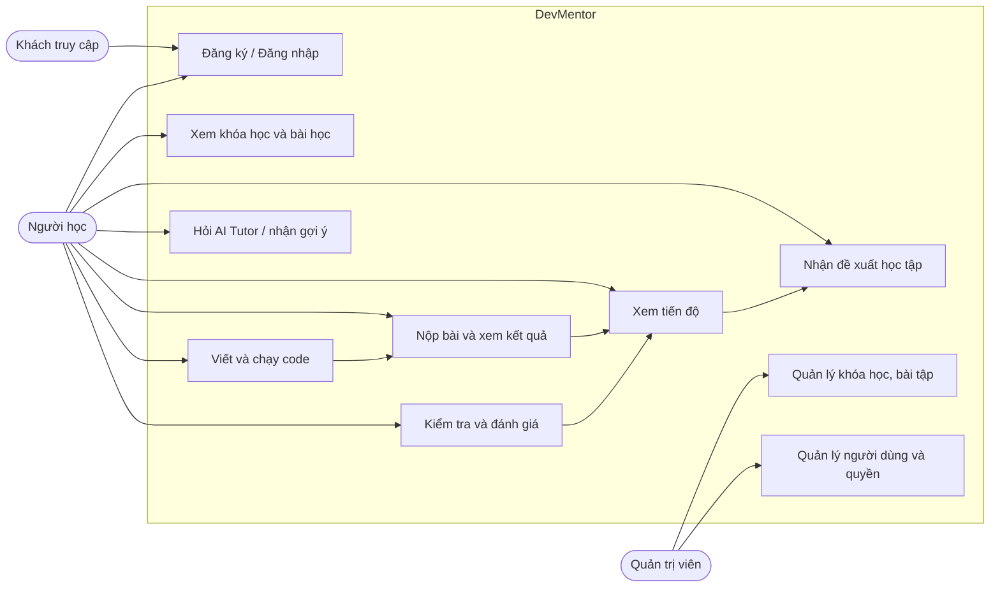
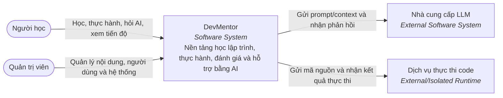
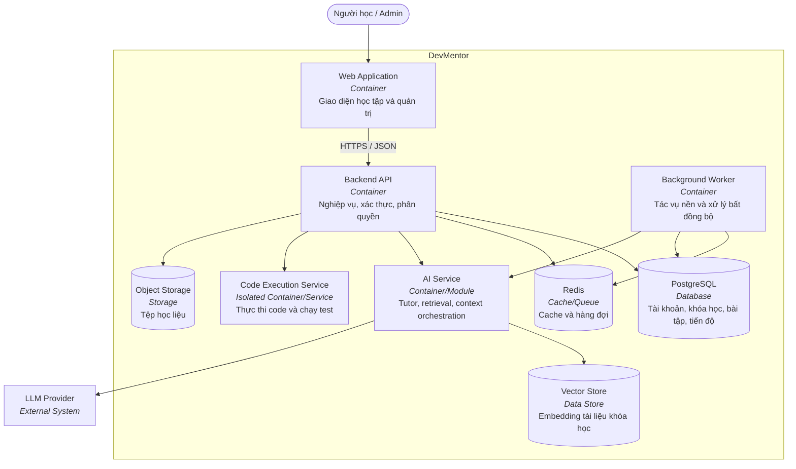
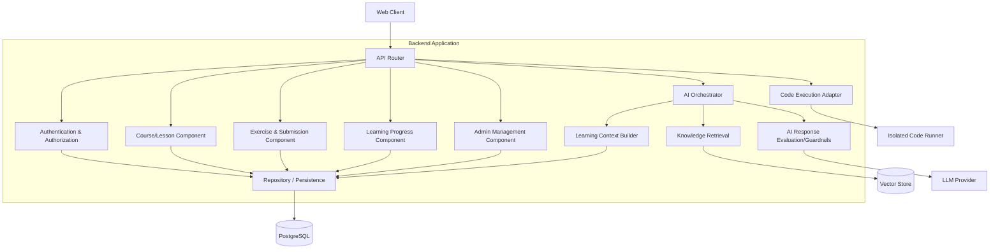
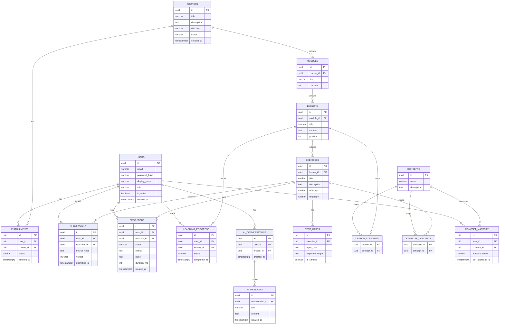

# DevMentor

**DevMentor** là nền tảng học lập trình tích hợp AI, giúp người học xây
dựng lộ trình phù hợp với năng lực, thực hành viết và chạy code, đồng
thời nhận hướng dẫn, gợi ý và phản hồi từ AI Tutor theo ngữ cảnh bài
học.

## 1. Requirements - INVEST, Use Case và Acceptance Criteria

Phần này xác định những gì DevMentor cần cung cấp, ai sử dụng, giá trị
mang lại và điều kiện có thể kiểm thử để xác nhận tính năng hoạt động
đúng.

### 1.1 Product Mind Map



Các nhóm chức năng chính:

-   **Đăng nhập & hồ sơ:** đăng ký, đăng nhập, quản lý thông tin cá
    nhân, đổi mật khẩu, vai trò và phân quyền.
-   **Dashboard:** tổng quan tiến độ học, khóa học đang học, thống kê
    bài tập, thành tích và streak.
-   **Khóa học & bài học:** khám phá khóa học, xem lộ trình, học nội
    dung, xem tài liệu/ví dụ code và đánh dấu hoàn thành.
-   **Coding Workspace:** code editor, chọn ngôn ngữ, chạy thử code, nộp
    bài và xem kết quả.
-   **AI Tutor:** giải thích khái niệm, gợi ý từng bước, phân tích/sửa
    lỗi, review code và hỏi đáp theo ngữ cảnh bài học.
-   **Kiểm tra & đánh giá:** placement test, quiz, coding challenge,
    chấm bài tự động và đánh giá độ phức tạp code.
-   **Lộ trình cá nhân hóa:** đề xuất lộ trình, theo dõi mức độ thành
    thạo, phát hiện kiến thức còn yếu và đề xuất bài học tiếp theo.
-   **Quản lý nội dung & Admin:** quản lý khóa học, bài học, bài tập,
    test case, người dùng, thống kê và giám sát hệ thống.

Trong đó, các năng lực tạo giá trị cốt lõi của sản phẩm là **AI Tutor**,
**Coding Workspace**, **Khóa học & bài học**, **Kiểm tra & đánh giá** và
**Lộ trình cá nhân hóa**. Đăng nhập, Dashboard và quản trị là các năng
lực hỗ trợ để vận hành sản phẩm.

### 1.2 Yêu cầu theo INVEST

Backlog V1 dưới đây là đề xuất ban đầu, tập trung vào vòng lặp học tập
cốt lõi: học kiến thức → thực hành code → nhận hỗ trợ → được đánh giá →
cập nhật tiến độ. Mỗi User Story cần được rà soát theo INVEST và liên
kết với Use Case, tiêu chí nghiệm thu, API, mô hình dữ liệu và kiểm thử.

| Tiêu chí | Ý nghĩa trong DevMentor |
| --- | --- |
| **Independent** | Mỗi User Story nên tạo ra giá trị có thể kiểm chứng; các phụ thuộc như tài khoản, khóa học hoặc bộ chấm bài phải được xác định rõ. |
| **Negotiable** | User Story mô tả kết quả người dùng cần đạt, không áp đặt sớm cách triển khai kỹ thuật. |
| **Valuable** | Tính năng phải hỗ trợ người học tiếp thu kiến thức, thực hành, cải thiện kỹ năng hoặc giúp quản trị viên vận hành nội dung. |
| **Estimable** | Phạm vi, quy tắc nghiệp vụ, dữ liệu đầu vào/đầu ra và các phụ thuộc đủ rõ để nhóm phát triển ước lượng. |
| **Small** | Một User Story nên có phạm vi vừa đủ để thiết kế, phát triển và kiểm thử trong một chu kỳ ngắn. |
| **Testable** | Mỗi Story có tiêu chí nghiệm thu quan sát được, bao gồm luồng thành công và các trường hợp lỗi/không đủ quyền. |

#### Backlog User Story V1

| ID | User Story | Actor | Ưu tiên | Phụ thuộc | Trạng thái |
| --- | --- | --- | --- | --- | --- |
| US01 | Là khách truy cập, tôi muốn đăng ký và đăng nhập để sử dụng các chức năng học tập của DevMentor. | Khách truy cập | Must | Không | Draft |
| US02 | Là người học, tôi muốn quản lý hồ sơ cá nhân để cập nhật thông tin tài khoản. | Người học | Should | US01 | Draft |
| US03 | Là người học, tôi muốn khám phá và xem nội dung khóa học để chọn nội dung phù hợp với mục tiêu. | Người học | Must | US01 | Draft |
| US04 | Là người học, tôi muốn xem bài học, tài liệu và ví dụ code để tiếp thu kiến thức theo từng chủ đề. | Người học | Must | US03 | Draft |
| US05 | Là người học, tôi muốn viết và chạy code trong Coding Workspace để thực hành ngay trong nền tảng. | Người học | Must | US01 | Draft |
| US06 | Là người học, tôi muốn nộp lời giải và nhận kết quả chấm tự động để biết bài làm có đáp ứng yêu cầu hay không. | Người học | Must | US05, bộ test | Draft |
| US07 | Là người học, tôi muốn hỏi AI Tutor về khái niệm trong bài học để hiểu nội dung đang học. | Người học | Must | US04 | Draft |
| US08 | Là người học, tôi muốn nhận gợi ý từng bước khi gặp khó khăn để tự tìm ra lời giải. | Người học | Must | US05, US07 | Draft |
| US09 | Là người học, tôi muốn AI phân tích lỗi thực thi để hiểu nguyên nhân và cách sửa code. | Người học | Must | US05, US07 | Draft |
| US10 | Là người học, tôi muốn làm placement test và quiz để kiểm tra kiến thức của mình. | Người học | Should | US01, ngân hàng câu hỏi | Draft |
| US11 | Là người học, tôi muốn xem tiến độ và kết quả học tập để biết mình đã hoàn thành những gì. | Người học | Should | US04, US06 | Draft |
| US12 | Là người học, tôi muốn nhận đề xuất bài học tiếp theo dựa trên kết quả học tập để cải thiện điểm yếu. | Người học | Could | US10, US11, dữ liệu kiến thức | Draft |
| US13 | Là quản trị viên, tôi muốn quản lý khóa học, bài học và bài tập để duy trì nội dung học tập. | Admin | Must | Phân quyền | Draft |
| US14 | Là quản trị viên, tôi muốn quản lý test case để xác định điều kiện chấm bài tự động. | Admin | Must | US13 | Draft |
| US15 | Là quản trị viên, tôi muốn quản lý người dùng và vai trò để kiểm soát quyền truy cập. | Admin | Should | US01 | Draft |

Ưu tiên: **Must** là cần thiết cho phạm vi V1; **Should** quan trọng
nhưng có thể triển khai sau các luồng cốt lõi; **Could** là phần mở rộng
khi đã có dữ liệu và nền tảng phù hợp.

### 1.3 Use Cases

Các Use Case chính được đề xuất cho V1:

| ID | Use Case | Actor chính | Kết quả |
| --- | --- | --- | --- |
| UC01 | Đăng ký tài khoản | Khách truy cập | Tài khoản được tạo nếu dữ liệu hợp lệ. |
| UC02 | Đăng nhập | Người dùng | Người dùng được xác thực và truy cập đúng phạm vi quyền. |
| UC03 | Xem và học bài học | Người học | Nội dung bài học được hiển thị và tiến độ được cập nhật theo quy tắc. |
| UC04 | Làm bài tập | Người học | Người học chạy/nộp lời giải và nhận kết quả. |
| UC05 | Chạy code | Người học | Code được thực thi trong sandbox và trả về kết quả. |
| UC06 | Nhận gợi ý hoặc hỗ trợ debug | Người học | AI phân tích ngữ cảnh và cung cấp hướng dẫn. |
| UC07 | Hỏi AI Tutor | Người học | AI trả lời dựa trên ngữ cảnh học tập và nguồn tri thức phù hợp. |
| UC08 | Làm bài kiểm tra đầu vào | Người học | Hệ thống ghi nhận kết quả đánh giá ban đầu. |
| UC09 | Xem tiến độ học tập | Người học | Người học xem trạng thái khóa học và kết quả học. |
| UC10 | Đề xuất nội dung học tiếp theo | Người học | Hệ thống đề xuất nội dung dựa trên dữ liệu học tập hiện có. |
| UC11 | Quản lý nội dung học tập | Admin | Nội dung khóa học và bài tập được tạo/cập nhật. |
| UC12 | Quản lý người dùng và quyền | Admin | Vai trò và quyền truy cập được quản lý. |



### 1.4 Vai trò và phân quyền

Các vai trò dưới đây là đề xuất ban đầu. Quyền thực tế cần được chốt
trong yêu cầu nghiệp vụ và kiểm thử bảo mật.

| Năng lực | Khách truy cập | Người học | Admin |
| --- | --- | --- | --- |
| Xem trang giới thiệu/khám phá công khai | Có | Có | Có |
| Đăng ký/đăng nhập | Có | Có | Có |
| Xem hồ sơ của mình | Không | Có | Có |
| Học khóa học | Không | Có | Có thể xem để kiểm tra |
| Chạy code và làm bài tập | Không | Có | Có thể kiểm tra |
| Sử dụng AI Tutor | Không | Có | Có thể kiểm tra |
| Xem tiến độ cá nhân | Không | Có | Có thể xem theo quyền quản trị |
| Quản lý khóa học/bài học/test case | Không | Không | Có |
| Quản lý người dùng và vai trò | Không | Không | Có |
| Xem thống kê quản trị | Không | Không | Có |

Backend phải thực thi xác thực và phân quyền ở từng API/resource. Việc
ẩn nút hoặc màn hình ở frontend không được xem là biện pháp bảo mật.

## 2. Kiến trúc thông tin, phân cấp màn hình và UI/UX

Kiến trúc thông tin tổ chức chức năng theo mục tiêu của người dùng. Các
màn hình cần định nghĩa rõ quyền truy cập và trạng thái loading, empty,
validation, error, saving và success.

### 2.1 Kiến trúc thông tin

``` mermaid
flowchart TB
    ROOT["**DevMentor**<br/>Nền tảng học lập trình tích hợp AI"]

    ROOT --> PUBLIC["Khu vực công khai"]
    ROOT --> LEARNER["Khu vực người học<br/>(Yêu cầu đăng nhập)"]
    ROOT --> ADMIN["Khu vực quản trị<br/>(Yêu cầu quyền Admin)"]

    subgraph PUBLIC_PAGES["CÁC MÀN HÌNH CÔNG KHAI"]
        direction TB
        HOME["**Trang chủ**<br/>Giới thiệu DevMentor<br/>Tính năng nổi bật<br/>Khóa học đề xuất<br/>CTA đăng ký"]
        EXPLORE["**Khám phá khóa học**<br/>Danh sách khóa học<br/>Tìm kiếm và lọc<br/>Danh mục / cấp độ"]
        PUBLIC_DETAIL["**Chi tiết khóa học công khai**<br/>Mô tả khóa học<br/>Mục tiêu và nội dung<br/>Yêu cầu đầu vào<br/>CTA đăng ký / đăng nhập"]
        REGISTER["**Đăng ký**<br/>Thông tin tài khoản<br/>Xác thực dữ liệu<br/>Thông báo kết quả"]
        LOGIN["**Đăng nhập**<br/>Email / mật khẩu<br/>Quên mật khẩu<br/>Thông báo lỗi xác thực"]
    end

    subgraph LEARNER_PAGES["CÁC MÀN HÌNH NGƯỜI HỌC"]
        direction TB
        DASH["**Dashboard**<br/>Tổng quan tiến độ học<br/>Khóa học đang học<br/>Thống kê bài tập<br/>Thành tích và streak"]

        COURSE_LIST["**Danh sách khóa học**<br/>Khóa học đã đăng ký<br/>Khám phá khóa học<br/>Tìm kiếm và lọc"]
        COURSE_DETAIL["**Chi tiết khóa học**<br/>Mô tả và mục tiêu<br/>Danh sách module / bài học<br/>Tiến độ khóa học"]
        LESSON["**Màn hình bài học**<br/>Nội dung bài học<br/>Tài liệu và ví dụ code<br/>Danh sách bài tập<br/>Đánh dấu hoàn thành"]

        WORKSPACE["**Coding Workspace**<br/>Code Editor<br/>Chọn ngôn ngữ<br/>Chạy thử code<br/>Nộp bài và xem kết quả<br/>Lịch sử chạy code"]
        TUTOR["**AI Tutor**<br/>Giải thích khái niệm<br/>Gợi ý từng bước (Hint)<br/>Phân tích và sửa lỗi (Debug)<br/>Review code<br/>Hỏi đáp theo ngữ cảnh bài học"]

        ASSESS["**Kiểm tra & đánh giá**<br/>Placement Test<br/>Quiz kiến thức<br/>Coding Challenge<br/>Kết quả và phản hồi"]

        PATH["**Lộ trình cá nhân hóa**<br/>Lộ trình học đề xuất<br/>Mức độ thành thạo<br/>Kiến thức còn yếu<br/>Bài học tiếp theo"]

        PROGRESS["**Tiến độ học tập**<br/>Tổng quan hoàn thành<br/>Lịch sử học tập<br/>Kết quả bài tập / kiểm tra"]

        PROFILE["**Hồ sơ cá nhân**<br/>Thông tin cá nhân<br/>Đổi mật khẩu<br/>Cài đặt tài khoản"]
    end

    subgraph ADMIN_PAGES["CÁC MÀN HÌNH QUẢN TRỊ"]
        direction TB
        ADMIN_DASH["**Dashboard quản trị**<br/>Thống kê người dùng<br/>Thống kê khóa học<br/>Hoạt động hệ thống"]

        ADMIN_COURSES["**Quản lý khóa học**<br/>Danh sách khóa học<br/>Tạo / sửa / ẩn khóa học<br/>Quản lý module"]

        ADMIN_LESSONS["**Quản lý bài học & bài tập**<br/>Tạo / sửa nội dung bài học<br/>Quản lý tài liệu và ví dụ code<br/>Tạo / sửa bài tập"]

        ADMIN_TESTS["**Quản lý test case**<br/>Tạo / sửa test case<br/>Quản lý test mẫu và test ẩn<br/>Kiểm tra cấu hình chấm"]

        ADMIN_USERS["**Quản lý người dùng**<br/>Danh sách người dùng<br/>Trạng thái tài khoản<br/>Vai trò và phân quyền"]

        ADMIN_MONITOR["**Thống kê & giám sát**<br/>Hoạt động người dùng<br/>Lượt chạy code / nộp bài<br/>Lượt sử dụng AI và chi phí<br/>Lỗi dịch vụ"]
    end

    PUBLIC --> HOME
    PUBLIC --> EXPLORE
    PUBLIC --> PUBLIC_DETAIL
    PUBLIC --> REGISTER
    PUBLIC --> LOGIN

    LEARNER --> DASH
    LEARNER --> COURSE_LIST
    COURSE_LIST --> COURSE_DETAIL
    COURSE_DETAIL --> LESSON
    LESSON --> WORKSPACE
    LESSON --> TUTOR
    LEARNER --> ASSESS
    LEARNER --> PATH
    LEARNER --> PROGRESS
    LEARNER --> PROFILE

    ADMIN --> ADMIN_DASH
    ADMIN --> ADMIN_COURSES
    ADMIN_COURSES --> ADMIN_LESSONS
    ADMIN_LESSONS --> ADMIN_TESTS
    ADMIN --> ADMIN_USERS
    ADMIN --> ADMIN_MONITOR

    classDef root fill:#ffffff,stroke:#222222,stroke-width:2px,color:#111111;
    classDef public fill:#fff0f0,stroke:#f87171,color:#7f1d1d;
    classDef learner fill:#ecfdf5,stroke:#22c55e,color:#14532d;
    classDef admin fill:#eff6ff,stroke:#60a5fa,color:#1e3a8a;
    class ROOT root;
    class HOME,EXPLORE,PUBLIC_DETAIL,REGISTER,LOGIN public;
    class DASH,COURSE_LIST,COURSE_DETAIL,LESSON,WORKSPACE,TUTOR,ASSESS,PATH,PROGRESS,PROFILE learner;
    class ADMIN_DASH,ADMIN_COURSES,ADMIN_LESSONS,ADMIN_TESTS,ADMIN_USERS,ADMIN_MONITOR admin;
```



### 2.2 Phân cấp màn hình

| Screen ID | Màn hình | Mục tiêu | Quyền |
| --- | --- | --- | --- |
| SCREEN-PUBLIC-HOME | Trang giới thiệu | Giới thiệu giá trị và chức năng DevMentor | Công khai |
| SCREEN-AUTH-REGISTER | Đăng ký | Tạo tài khoản | Khách |
| SCREEN-AUTH-LOGIN | Đăng nhập | Xác thực người dùng | Khách |
| SCREEN-LEARNER-DASHBOARD | Dashboard người học | Tổng quan hoạt động học tập | Người học |
| SCREEN-COURSE-LIST | Danh sách khóa học | Khám phá khóa học | Người học |
| SCREEN-COURSE-DETAIL | Chi tiết khóa học | Xem mục tiêu và cấu trúc khóa học | Người học |
| SCREEN-LESSON | Bài học | Xem nội dung và tài liệu | Người học |
| SCREEN-CODING-WORKSPACE | Coding Workspace | Viết, chạy và nộp code | Người học |
| SCREEN-AI-TUTOR | AI Tutor | Hỏi đáp, Hint, Debug, Review | Người học |
| SCREEN-ASSESSMENT | Kiểm tra & đánh giá | Làm quiz/challenge | Người học |
| SCREEN-LEARNING-PATH | Lộ trình cá nhân hóa | Xem và theo dõi lộ trình | Người học |
| SCREEN-PROGRESS | Tiến độ học tập | Xem kết quả và mức độ thành thạo | Người học |
| SCREEN-PROFILE | Hồ sơ cá nhân | Quản lý thông tin tài khoản | Người học |
| SCREEN-ADMIN-COURSES | Quản lý khóa học | Quản trị nội dung khóa học | Admin |
| SCREEN-ADMIN-USERS | Quản lý người dùng | Quản trị tài khoản và vai trò | Admin |

Luồng học chính: Dashboard → Khóa học → Bài học → Coding Workspace →
Chạy/Nộp bài → Nhận kết quả và hỗ trợ AI → Cập nhật tiến độ.

Luồng AI Tutor cần hiển thị rõ câu hỏi, câu trả lời, nguồn/ngữ cảnh được
sử dụng (nếu có), trạng thái đang xử lý và khả năng gửi phản hồi. Với
Hint, giao diện nên ưu tiên gợi ý từng bước thay vì tự động hiển thị lời
giải hoàn chỉnh.

### 2.3 Nguyên tắc UI/UX

-   Giữ bài học, editor, kết quả chạy code và AI Tutor gần nhau để giảm
    việc chuyển màn hình.
-   Phân biệt rõ **Chạy thử** và **Nộp bài**: chạy thử phục vụ thực
    hành; nộp bài mới kích hoạt quy trình chấm chính thức.
-   Hiển thị lỗi theo cách dễ hiểu, có thể xem chi tiết kỹ thuật khi
    cần.
-   Cho phép người học yêu cầu mức trợ giúp tăng dần.
-   Hiển thị tiến độ dựa trên bài học, bài tập và kết quả đánh giá;
    không chỉ dựa trên thời gian mở trang.
-   Thiết kế trạng thái rỗng, loading, lỗi mạng, lỗi thực thi, timeout
    và hết phiên đăng nhập.
-   Đảm bảo điều hướng bằng bàn phím, nhãn dễ hiểu, độ tương phản phù
    hợp và thông báo lỗi có thể nhận biết.

### 2.4 Prototype giao diện hiện tại

Chưa có đường dẫn prototype hoặc ảnh màn hình được xác nhận trong tài
liệu đầu vào. Khi có prototype, bổ sung ảnh theo cấu trúc:

``` text
docs/
└── images/
    ├── learner/
    │   ├── dashboard.png
    │   ├── lesson.png
    │   ├── coding-workspace.png
    │   └── ai-tutor.png
    └── admin/
        ├── course-management.png
        └── user-management.png
```

## 3. Kiến trúc C4

Phần này mô tả kiến trúc ở ba mức: System Context (C1), Container (C2)
và Component (C3). Đây là kiến trúc logic đề xuất cho V1, không phải sơ
đồ triển khai đã được xác nhận.

### C1 - System Context



### C2 - Container



### C3 - Component



**Ghi chú kiến trúc**

-   Có thể bắt đầu bằng modular monolith: một backend được chia module
    nghiệp vụ rõ ràng. Chỉ tách service khi có nhu cầu mở rộng, cô lập
    bảo mật hoặc triển khai độc lập.
-   Code Execution cần ranh giới cô lập riêng; không chạy mã người dùng
    trong tiến trình API.
-   AI Orchestrator chịu trách nhiệm tạo ngữ cảnh và điều phối các tác
    vụ như Explain, Hint, Debug, Review.
-   RAG dùng để truy xuất học liệu; không thay thế compiler, runtime
    hoặc test engine.
-   Việc đánh giá đúng/sai của bài coding cần dựa trên kết quả thực thi
    và test case xác định.
-   Các lời gọi LLM cần có timeout, giới hạn token, kiểm soát chi phí,
    logging phù hợp và xử lý lỗi nhà cung cấp.

Tham chiếu tài liệu chi tiết dự kiến:

-   [C4 Architecture](docs/architecture/c4/README.md)
-   [arc42 Architecture Handbook](docs/architecture/arc42/README.md)

## 4. Sơ đồ cơ sở dữ liệu và hợp đồng OpenAPI 3.0

Phần này định hướng mô hình lưu trữ và hợp đồng HTTP giữa frontend,
backend và các dịch vụ liên quan. Schema và endpoint bên dưới là đề xuất
cần được xác nhận trong quá trình thiết kế chi tiết.

### 4.1 Sơ đồ cơ sở dữ liệu



Các nhóm dữ liệu chính:

-   **Identity:** Users, vai trò và trạng thái tài khoản.
-   **Learning Content:** Courses, Modules, Lessons, Exercises, Test
    Cases.
-   **Coding:** Executions và Submissions.
-   **Learning Analytics:** Enrollments, Learning Progress, Concepts,
    Concept Mastery.
-   **AI:** AI Conversations và AI Messages.

Các bảng trên là mô hình khởi đầu. Cần bổ sung ràng buộc unique, index,
audit fields, chính sách xóa/lưu trữ, phân quyền theo tài nguyên và
thiết kế lưu trữ test case an toàn khi hoàn thiện schema.

Tài liệu dự kiến:

-   [Sơ đồ database](docs/DATABASE.md)
-   [Data Model](docs/05-data-model.md)
-   [Database
    migration/schema](backend/migrations/%20hoặc%20đường%20dẫn%20tương%20ứng%20sau%20khi%20chốt%20cấu%20trúc%20repository)

### 4.2 Tài liệu API theo OpenAPI 3.0

API contract dự kiến sử dụng OpenAPI 3.0, chia theo các nhóm nghiệp vụ:

| Nhóm API | Trách nhiệm |
| --- | --- |
| Authentication | Đăng ký, đăng nhập, đăng xuất, làm mới phiên |
| Users | Hồ sơ cá nhân và thông tin người dùng |
| Courses | Danh sách, chi tiết và đăng ký khóa học |
| Lessons | Nội dung bài học và trạng thái hoàn thành |
| Exercises | Chi tiết bài tập và starter code |
| Executions | Chạy code thử trong sandbox |
| Submissions | Nộp bài và lấy kết quả chấm |
| AI Tutor | Hỏi đáp, Hint, Debug và Review code |
| Assessments | Placement test và quiz |
| Learning Progress | Tiến độ và kết quả học tập |
| Learning Path | Lộ trình và đề xuất nội dung |
| Admin | Quản lý nội dung, người dùng và test case |

Các endpoint minh họa dưới đây là tên dự kiến, chưa phải API đã triển
khai:

``` text
POST   /api/v1/auth/register
POST   /api/v1/auth/login
POST   /api/v1/auth/logout
GET    /api/v1/users/me
PATCH  /api/v1/users/me

GET    /api/v1/courses
GET    /api/v1/courses/{courseId}
POST   /api/v1/courses/{courseId}/enroll
GET    /api/v1/lessons/{lessonId}
POST   /api/v1/lessons/{lessonId}/complete

GET    /api/v1/exercises/{exerciseId}
POST   /api/v1/executions
GET    /api/v1/executions/{executionId}
POST   /api/v1/submissions
GET    /api/v1/submissions/{submissionId}

POST   /api/v1/ai/tutor
POST   /api/v1/ai/hint
POST   /api/v1/ai/debug
POST   /api/v1/ai/review

POST   /api/v1/assessments/{assessmentId}/attempts
GET    /api/v1/learning/progress
GET    /api/v1/learning/path
GET    /api/v1/learning/recommendations

/api/v1/admin/courses
/api/v1/admin/lessons
/api/v1/admin/exercises
/api/v1/admin/test-cases
/api/v1/admin/users
```

**Quy ước API đề xuất**

-   Sử dụng JSON cho request/response thông thường.
-   Các endpoint yêu cầu xác thực phải kiểm tra token/phiên ở backend.
-   Endpoint quản trị phải kiểm tra quyền Admin ở backend.
-   Có validation cho dữ liệu đầu vào, giới hạn kích thước request và
    rate limiting phù hợp.
-   API chạy code nên hỗ trợ xử lý bất đồng bộ khi thời gian thực thi
    vượt quá ngưỡng phản hồi đồng bộ.
-   Không trả về test case ẩn, đáp án hoặc dữ liệu nhạy cảm cho người
    học.
-   Chuẩn hóa mã lỗi và cấu trúc error response.
-   Không ghi token, mật khẩu, mã nguồn nhạy cảm hoặc dữ liệu cá nhân
    không cần thiết vào log.

**Tài liệu API dự kiến**

-   [OpenAPI specification](docs/api/openapi.yaml)
-   [API documentation và ví dụ request/response](docs/api/README.md)

## Phạm vi và các giả định cần xác nhận

Để tránh hiểu các đề xuất như quyết định đã được chốt, các điểm sau cần
được xác nhận trong giai đoạn phân tích:

1.  **Đối tượng và vai trò:** V1 phục vụ người mới học lập trình hay cả
    sinh viên/người đã có kinh nghiệm; có cần vai trò giảng viên riêng
    không?
2.  **Ngôn ngữ lập trình:** V1 hỗ trợ Python trước hay cần thêm
    JavaScript/C++?
3.  **Nội dung khóa học:** Nội dung do nhóm dự án tự biên soạn, lấy từ
    nguồn mở hay do giảng viên đóng góp?
4.  **Code execution:** Chọn dịch vụ sandbox, giới hạn tài nguyên và
    chính sách mạng/tệp như thế nào?
5.  **AI provider:** Chọn LLM nào, ngân sách theo người dùng và cách
    đánh giá chất lượng phản hồi ra sao?
6.  **RAG:** Nguồn tài liệu nào được phép đưa vào knowledge base và cách
    cập nhật/kiểm duyệt nội dung?
7.  **Cá nhân hóa:** V1 dùng quy tắc dựa trên kết quả bài tập hay triển
    khai Knowledge Tracing ngay từ đầu?
8.  **Triển khai:** Quy mô người dùng dự kiến, môi trường cloud,
    logging, monitoring và yêu cầu bảo vệ dữ liệu.

## Hướng dẫn đóng góp và cập nhật tài liệu

Khi cập nhật yêu cầu hoặc kiến trúc:

1.  Cập nhật User Story và Acceptance Criteria.
2.  Kiểm tra lại Use Case và phân quyền.
3.  Cập nhật Screen ID và luồng UI/UX liên quan.
4.  Cập nhật sơ đồ C4, database và OpenAPI khi có thay đổi.
5.  Bổ sung hoặc cập nhật test tương ứng.
6.  Giữ các ID như `USxx`, `UCxx`, `SCREEN-...` ổn định để hỗ trợ truy
    vết.

------------------------------------------------------------------------

**DevMentor - Learn to code with a mentor by your side.**
